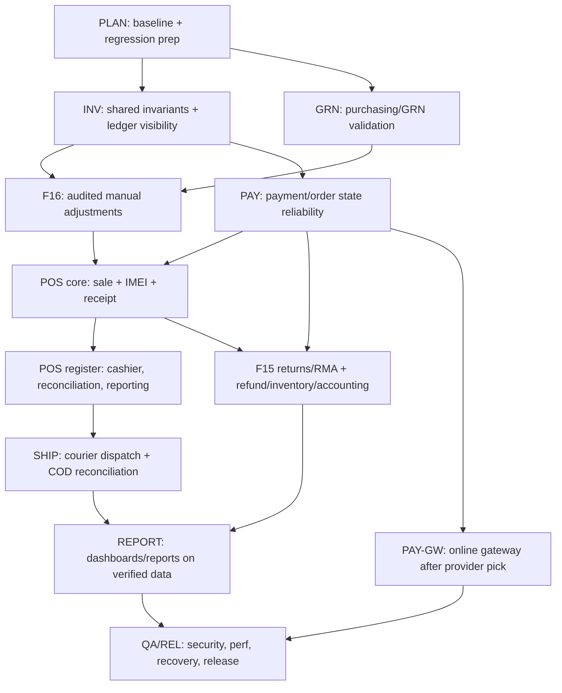

# CellCraze — Master Implementation Roadmap

**Status:** Planning/audit only — no application code, DB, commits (beyond these planning
docs), or deployments were changed in producing this.
**Source of truth** for scope, current-state, phases, task registry, risks, decisions, DoD.

> **ENVIRONMENT CAVEAT — read first.** This roadmap was produced in the **cloud session on a
> clean `main` checkout at commit `2445700`**, auditing the *committed* code. It does **not**
> reflect the main laptop's **uncommitted** working tree (notably in-progress GRN work in
> `class-cellcraze-purchasing.php`) or three laptop-only docs that are not in this checkout:
> `CELlCRAZE-EXISTING-FEATURES-AUDIT.md`, `CELLCRAZE-FEATURE-GAP-IMPLEMENTATION-PLAN.md`,
> `F16-IMPLEMENTATION-KICKOFF.md`. **Before executing any task, re-verify against the laptop's
> actual working tree and preserve all uncommitted work** (rules §1). Where this doc and the
> laptop disagree, the laptop's live code wins — reconcile, don't overwrite.

---

## 1. Scope & requirements

CellCraze is a **single-shop** phone & accessories business (Sri Lanka, LKR) selling **online
(WooCommerce)** and **in-store (POS)** from **one shared inventory**, with **IMEI/serial
tracking** for every phone. Modules: storefront, catalogue/inventory (serialized + quantity),
suppliers/purchasing/GRN, audited manual stock adjustments (F16), POS, returns/RMA (F15),
payments (cash/COD/bank-slip/card-terminal/online gateway), courier/COD, expenses/COGS/profit,
dashboard, roles/security, communications, QA/release.

**Non-negotiables:** HPOS; never force `_stock` to equal IMEI row count; serialized sales
allocate the correct IMEI and never double-sell; returns never auto-sellable (explicit audited
regrade); no negative stock via manual adjustment; every inventory/money/IMEI movement is
audited; no double-decrement across Woo/POS/IMEI/purchasing.

## 2. Architecture & business invariants (verified from code)

**Custom tables** (all `dbDelta`, additive): `wp_cellcraze_imei`, `_po`, `_po_item`, `_grn`,
`_grn_item`, `_supplier`, `_expense`, `_audit`.

**IMEI model** (`class-cellcraze-imei-db.php`): states `available | reserved | sold | damaged |
returned`; `imei` is `UNIQUE` (duplicate prevention at the DB). **Atomic claim** via
`mark_sold()` = `UPDATE … WHERE id=%d AND status='available'` (compare-and-set; returns
rows-affected). FIFO allocation in `class-cellcraze-imei-orders.php::assign_order()` is
**idempotent** (tops up only missing units), **concurrency-safe** (over-fetches a candidate pool,
falls through on lost race), and **audit-logged** with an idempotent `event_key`
(`imei_assign:{unit}:{order}:{sold_at-epoch}`).

**Audit ledger** (`class-cellcraze-audit.php`, table `_audit`): append-only `log()` with
`event_key` dedupe; subscribes to `woocommerce_reduce_order_stock` / `restore_order_stock` and
`set_user_role`. This is the canonical movement/audit log (T-101 built).

**Shared-logic ownership (must NOT be reimplemented per module):**
- IMEI claim/restore → `Cellcraze_IMEI_DB::mark_sold()/restore()` only.
- Order→IMEI lifecycle → `Cellcraze_IMEI_Orders` (hooks: processing/completed assign; cancelled/
  refunded restore).
- Qty stock writes → WooCommerce (`wc_update_product_stock`) — one writer; GRN reuses
  `IMEI_Admin::receive()` + `wc_update_product_stock`, never a competing count.
- Audit → `Cellcraze_Audit::log()` only.
- COGS capture → `Cellcraze_COGS` (on processing/completed).
- Channel tag → `Cellcraze_Channel` (online/pos).

**Capabilities** (`class-cellcraze-roles.php`): `cellcraze_use_pos`, `cellcraze_receive_stock`,
`cellcraze_manage_imei`, `cellcraze_manage_expenses`, `cellcraze_view_reports`. Roles:
`cc_cashier`, `cc_warehouse`, `cc_order_processing` + admin/shop_manager. **Not yet present:**
`cellcraze_adjust_stock` (F16).

**REST** (`class-cellcraze-rest.php`, ns `cellcraze/v1`): `GET /imei/available`,
`POST /imei/assign`, `POST /channel`; permission `cellcraze_manage_imei || manage_woocommerce`.

## 3. Verified current-state summary (evidence-based)

**Implemented & verified** (code read + existing `docs/FEATURE-TRACEABILITY.md`):
IMEI atomic claim (CC-03), IMEI lifecycle (CC-04), receiving↔stock sync (CC-06), bank-slip
upload/verify (CC-09), staff roles/caps (CC-13), suppliers (ADM-09), PO/GRN incl. partial +
idempotent `grn_token` + over-receive guard (ADM-10), channel tagging (ADM-05), dashboard with
real KPIs (ADM-08), COGS capture, expenses, stock-movement/audit ledger (T-101). Storefront:
homepage, catalogue, PDP, cart/checkout/guest, accounts, wishlist (CUS-01…13 largely verified).

**Partial:** storefront filters/sorting (CUS-05 — sort only), variants (CUS-06 — attributes
exist, products still `simple`), inventory valuation/reconciliation report (ADM-11), policy pages
(CUS-15).

**Missing:** POS (register/sale/receipt/reconciliation), F15 returns/RMA, courier/delivery +
COD remittance, online card gateway, low-stock/reorder alerts, contact/FAQ pages, SMS/WhatsApp.

**Broken/risky:** **F16 gap** — `IMEI_Admin::handle_delete_imei()` decrements stock
(`adjust_stock(..,-1)`) on deleting an *available* unit **without an audit entry**, and there is
**no `cellcraze_adjust_stock` cap / reasoned adjustment workflow**. Delete is gated only by
`manage_woocommerce`.

**Cannot verify (DB unavailable / not exercised):** anything depending on live DB state or real
orders — do **not** infer DB state from source. MySQL/MariaDB on the laptop had Aria/`mysql.plugin`
startup issues; treat DB-dependent verification as **blocked** there (read-only diagnosis only;
never force-recover).

## 4. Module gap analysis → see per-module detail in `CELLCRAZE-TASK-SPECS.md`.
Each module's existing/missing/dependencies/risks/tasks/acceptance live in the task specs; the
registry (§6) is the index.

## 5. Phases & dependency graph

**Phase table** (goal · reuse · effort · DoD summary):

| Phase | Goal / outcome | Reuse | Effort | DoD |
|---|---|---|---|---|
| PLAN | Baseline verify + regression harness, env/DB diagnosis | existing traceability/tests | M | reproducible baseline + green regression set recorded |
| INV | Lock shared invariants, stock-movement visibility, low-stock alerts | `_audit`, IMEI_DB | M | invariants documented + enforced; movement viewer; alerts |
| GRN | Validate/complete purchasing+GRN reliability (preserve laptop WIP) | Purchasing, grn_token | S–M | partial/retry/over-receive covered by tests; no double count |
| F16 | Audited manual stock adjustments; fix unaudited delete decrement | Audit, IMEI_DB | M | cap+reasons+limits+audit; delete decrement audited; IMEI-safe |
| PAY | Payment/order-state reliability + online stock sync (COD/BACS/slip) | BankSlip, Channel | M | states reconcile; slip≠paid; dup-callback safe |
| POS core | Shared-inventory sale: cart→IMEI alloc→order→receipt | IMEI_Orders, REST | L | POS sale == Woo order accounting + audit + IMEI rules |
| POS reg | Cashier perms, register open/close, cash reconciliation, POS vs online | Roles, Reports | L | reconciliation balances; perms enforced; reporting splits |
| F15 RMA | Returns: order link, limits, inspection, regrade, refund, accounting | IMEI_DB, COGS | L–XL | refund/inventory/accounting are separate+coordinated; idempotent |
| SHIP | Courier dispatch/tracking, COD collection/remittance, notifications | Channel, orders | M–L | manual courier workflow + COD reconciliation + audit |
| REPORT | Dashboards/reports on verified data; valuation; reconciliation | Reports, Dashboard | M | numbers reconcile to orders/POS/stock/payments; no fake data |
| PAY-GW | Online card gateway after provider decision (D1) | Woo gateways | M | blocked on D1; sandbox-tested before "operational" |
| QA/REL | Regression, security, perf, recovery, release readiness | test strategy | M–L | release checklist green on staging |

## 6. Prioritized task registry (index — full specs in `CELLCRAZE-TASK-SPECS.md`)

P0 = correctness/safety/unblocks; P1 = core feature; P2 = enhancement.

| ID | Title | P | Phase | Depends |
|---|---|---|---|---|
| PLAN-01 | Baseline verify + regression harness + DB/env diagnosis | P0 | PLAN | — |
| INV-01 | Document + assert shared inventory invariants (central guard) | P0 | INV | PLAN-01 |
| INV-02 | Stock-movement viewer (read-only) over `_audit` | P1 | INV | PLAN-01 |
| INV-03 | Low-stock / reorder alerts (admin + optional email) | P1 | INV | INV-02 |
| GRN-01 | Validate purchasing/GRN reliability; reconcile laptop WIP | P0 | GRN | PLAN-01 |
| F16-01 | `cellcraze_adjust_stock` cap + reasons + magnitude/validation | P0 | F16 | INV-01 |
| F16-02 | Audited adjustment service + IMEI-state guards | P0 | F16 | F16-01 |
| F16-03 | Fix unaudited stock decrement on available-IMEI delete | P0 | F16 | F16-02 |
| PAY-01 | Payment/order-state reliability + slip≠paid + dup-callback guard | P0 | PAY | PLAN-01 |
| POS-01 | POS sale lifecycle (cart→IMEI alloc→Woo order→stock→audit) | P1 | POS core | F16-02, PAY-01 |
| POS-02 | POS receipt/invoice + print | P1 | POS core | POS-01 |
| POS-03 | POS register open/close + cash reconciliation + cashier perms | P1 | POS reg | POS-01 |
| POS-04 | POS vs online reporting | P2 | POS reg | POS-03, REPORT-01 |
| RMA-01 | Returns intake: order/line link, limits, reasons, IMEI validation | P1 | F15 | PAY-01 |
| RMA-02 | Inspection → regrade/quarantine/damage/write-off (audited) | P1 | F15 | RMA-01, F16-02 |
| RMA-03 | Refund (orig method where supported) + COGS/profit reversal | P1 | F15 | RMA-02 |
| SHIP-01 | Manual courier dispatch + tracking + statuses | P1 | SHIP | PAY-01 |
| SHIP-02 | COD collection + remittance reconciliation | P1 | SHIP | SHIP-01 |
| REPORT-01 | Reconciliation/valuation reports on verified data | P1 | REPORT | INV-02 |
| PAY-GW-01 | Online card gateway (after D1) — sandbox then live | P1 | PAY-GW | D1 |
| QA-01 | Regression + security + HPOS + recovery + release checklist | P0 | QA/REL | all |

## 7. Risk register (top)
- **R1 Double-decrement** across Woo/POS/IMEI/purchasing → single-writer rule (INV-01); POS uses
  Woo order accounting, never direct `_stock`.
- **R2 Unaudited/negative adjustments** → F16 cap + validation + audit (F16-01..03).
- **R3 Returns auto-sellable** → RMA regrade is explicit+audited (RMA-02); refund ≠ restock.
- **R4 Duplicate payment/refund/webhook** → idempotency keys everywhere money moves (PAY-01,
  RMA-03, PAY-GW-01).
- **R5 DB unavailable / laptop Aria issue** → DB-dependent verification blocked; no forced
  recovery; read-only diagnosis only.
- **R6 Cloud/laptop divergence** → reconcile before executing (env caveat).

## 8. Unresolved decisions → `CELLCRAZE-DECISIONS-AND-OPEN-QUESTIONS.md` (D1 gateway, D2 POS
approach, D3 ATUM-Pro vs custom purchasing, D4 courier, D5 RMA approach, D6 COGS method, D7 tax,
D8 warranty, D9 multi-branch=single confirmed, D10 SMS/WhatsApp).

## 9. Definition of done & release readiness
A task is done only when: business logic + authorization + data integrity + idempotency/
concurrency + tests (run, not assumed) are verified, regression stays green, and the status
tracker is updated with evidence. Release checklist in `CELLCRAZE-IMPLEMENTATION-PROTOCOL.md`.

## 10. Regression strategy
Preserve green: CC-03/04/06/09/13, ADM-05/08/09/10, T-101. Every inventory/payment/IMEI/refund
task must add duplicate-submission, partial-failure, concurrency, and reconciliation checks.
Testing approach adapted to the repo's actual setup (no assumption of PHPUnit) — see protocol.
